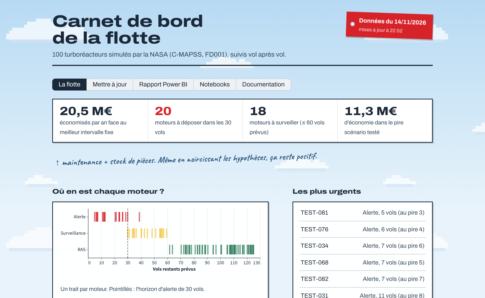

# Maintenance prédictive et stock de pièces pour une flotte de turboréacteurs

Prédire combien de vols il reste à chaque moteur, en déduire quand le déposer et combien de modules de rechange garder en stock, chiffrer ce que ça rapporte, et le restituer à des décideurs dans Power BI.

Données : **NASA C-MAPSS**, sous-ensemble FD001 (100 moteurs suivis jusqu'à la panne pour l'entraînement, 100 moteurs en service pour le test).

> Projet personnel d'étude, sans lien avec Safran, CFM International ni la NASA. Les coûts sont des hypothèses publiques ou raisonnées, documentées dans le notebook 05.



## Ce que ça donne

| Question | Réponse (jeu de test et simulations) |
|---|---|
| Combien de vols reste-t-il à chaque moteur ? | Erreur moyenne de **12 vols**, environ 6 vols sur les moteurs proches de la panne, avec une fourchette à 80 % vérifiée |
| Quels moteurs déposer dans les 30 prochains vols ? | Règle d'alerte : 95 % des alertes sont justes, aucune fausse alerte sur un moteur sain, 76 % des moteurs à déposer signalés (19 sur 25) |
| Combien de modules garder en stock ? | Seuil de commande recalculé chaque jour à partir des probabilités de panne : **stock moyen de 10 à 6 modules**, attentes de moteurs divisées par 8 (taux de service 95 %) |
| Combien ça rapporte ? | **20 M€ par an** pour 100 moteurs face au meilleur intervalle fixe (maintenance + stock), encore 11 M€ dans le pire scénario testé |

## Démarche

| # | Notebook | Question | Méthode |
|---|---|---|---|
| 01 | Exploration | Les capteurs annoncent-ils la panne ? | Corrélations de Spearman, choix de 12 capteurs, plafond de RUL à 125 vols |
| 02 | Modèle RUL | Combien de vols reste-t-il ? | Variables d'historique (moyenne glissante, écart au moteur neuf, pente), gradient boosting, **validation par moteur** (GroupKFold), régression quantile calibrée |
| 03 | Alertes | Quels moteurs planifier ? | Seuil + persistance sur 2 vols + filet de sécurité sur la borne basse |
| 04 | Stock | Combien de modules, quand commander ? | Politique [R, Q] classique contre seuil R(t) piloté par le modèle (loi de Poisson-binomiale), simulation de 10 ans × 10 flottes |
| 05 | Business case | Combien économise-t-on ? | Coût par vol de 3 stratégies, sensibilité ±50 % (tornade), point mort |

Chaque notebook explique ses choix pour un lecteur non spécialiste et vérifie ses calculs sur des cas connus (cellules ✅).

## Structure

```
├── data/raw/               Fichiers NASA C-MAPSS, non modifiés
├── data/processed/         Données préparées par les notebooks
├── notebooks/              Les 5 étapes, de 01 à 05
├── src/                    Code partagé : chargement des données, construction des variables
├── outputs/figures/        Graphiques des notebooks
├── outputs/powerbi/        10 tables CSV en schéma en étoile, lues par Power BI
├── outils/                 Génération et vérification du rapport Power BI
├── powerbi_assets/         Thème et fonds de page du rapport
├── docs/                   Contexte métier, bibliographie annotée, fiches de lecture, images
├── centre_de_controle.py   Interface Streamlit pour tout piloter (assets/ et static/ : son style)
└── run_pipeline.py         Relance les 5 notebooks dans l'ordre
```

## Installation

```powershell
python -m venv .venv
.\.venv\Scripts\Activate.ps1        # sous macOS/Linux : source .venv/bin/activate
pip install -r requirements.txt
```

Puis, au choix :

- **L'interface** : `python -m streamlit run centre_de_controle.py`.
- **Tout recalculer** : `python run_pipeline.py` (environ 2 minutes), ou `python run_pipeline.py --depuis 3` pour repartir d'un notebook.
- **Les notebooks un par un** : ouvrir `notebooks/01_exploration_FD001.ipynb` dans VS Code ou Jupyter, choisir l'environnement `.venv`, *Run All*.

## Le rapport Power BI

Le rapport est écrit sous forme de code (format Power BI Project : modèle sémantique TMDL et pages PBIR en JSON) par `outils/generer_rapport_powerbi.py`. Il n'est pas versionné, parce qu'il contient le chemin des données sur le poste qui l'a généré.

1. `python outils/generer_rapport_powerbi.py` : écrit `rapport/Maintenance predictive.pbip`.
2. L'ouvrir dans Power BI Desktop, puis **Accueil → Actualiser**.
3. Contrôle facultatif : `python outils/valider_rapport_powerbi.py [clone de github.com/microsoft/json-schemas]` vérifie les champs utilisés par chaque visuel, les types de données et, si on lui donne le dépôt, les schémas officiels de Microsoft.

| Page | Question |
|---|---|
| Accueil | Navigation et chiffres clés |
| Business case | Combien ça rapporte, et est-ce robuste ? |
| Flotte | Quels moteurs traiter, et pourquoi ? |
| Stock | Combien de modules garder ? |
| Fiche moteur | Que disent les capteurs de ce moteur ? (page d'extraction) |

Maquettes des pages dans `docs/images/rapport_*.png`.

## Style du code

Le code est mis en forme et vérifié avec [ruff](https://docs.astral.sh/ruff/) (`ruff.toml`, lignes de 100 caractères) : `ruff format .` puis `ruff check .`.

## Références

Le contexte métier, un glossaire et 14 références annotées sont dans [`docs/contexte_et_references.md`](docs/contexte_et_references.md). Cinq d'entre elles ont une fiche de lecture dans [`docs/corpus_lectures.md`](docs/corpus_lectures.md).

Source des données : Saxena, A., Goebel, K., Simon, D., Eklund, N. (2008). *Damage propagation modeling for aircraft engine run-to-failure simulation*. PHM08, Denver. Jeu de données publié par le NASA Prognostics Center of Excellence.
